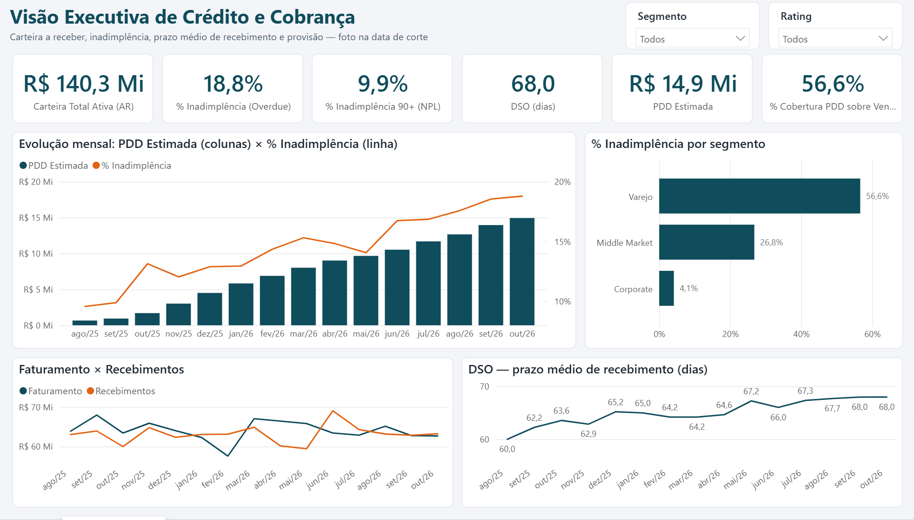
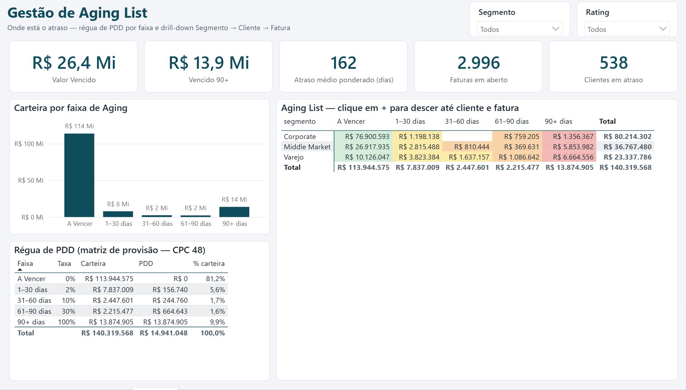
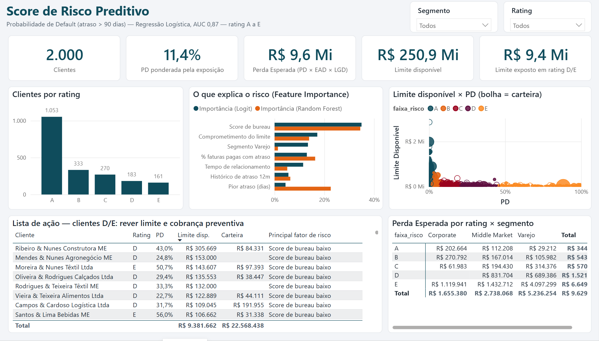
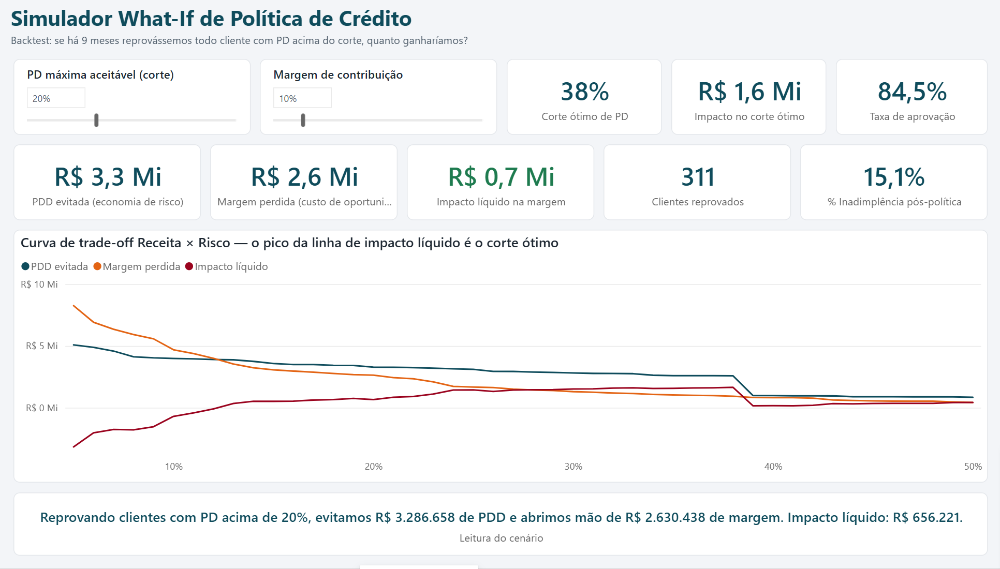

# 💳 Painel de Risco de Crédito, Contas a Receber e Inadimplência
### Aging List + PDD + Score Preditivo de Default + Simulador de Política de Crédito


> Projeto de portfólio que une **conhecimento financeiro** (Contas a Receber, DSO, Aging, PDD) com
> **Ciência de Dados** (modelo de Probabilidade de Default) e **BI** (DAX avançado + simulação What-If)
> para responder a pergunta que todo CFO faz: *"quanto risco vale a pena correr para vender mais?"*



---

## 🎯 O problema de negócio

A área de Crédito & Cobrança vive um trade-off permanente:

- **Crédito frouxo** → vende mais, mas a inadimplência e a PDD corroem o resultado.
- **Crédito rígido** → carteira limpa, mas o comercial perde bons clientes (e margem) para a concorrência.

Este painel mede os dois lados na mesma moeda (R$ de margem) e encontra o **corte de risco ótimo**.

## 🏗️ Arquitetura

```
generate_ar_data.py ──► data/dim_clientes.csv ─────────────┐
                    └─► data/fato_faturas.csv ─────────────┤
                                  │                         │
credit_scoring.py ◄───────────────┘                         ├──► Power BI (4 páginas, DAX)
        ├─► data/clientes_score_preditivo.csv ─────────────┤
        └─► data/feature_importance.csv ───────────────────┘
```

## 🚀 Como rodar

```bash
python -m venv .venv
.venv\Scripts\activate          # Linux/Mac: source .venv/bin/activate
pip install -r requirements.txt
python generate_ar_data.py      # gera a base de AR (~1s)
python credit_scoring.py        # treina o modelo, exporta score e imprime o backtest
```

Depois abra **`powerbi/PainelRiscoCredito.pbip`** no Power BI Desktop e clique em **Atualizar**.
O relatório está versionado como código ([Power BI Project](https://learn.microsoft.com/power-bi/developer/projects/projects-overview)):
o modelo semântico em TMDL (`PainelRiscoCredito.SemanticModel/`) e as 4 páginas em PBIR, geradas por
`powerbi/build_report.py`.

> Ao clonar o repositório em outra pasta, ajuste o parâmetro **PastaDados**
> (*Transformar dados → Gerenciar parâmetros*) para o caminho da sua pasta `data\`.

Todas as medidas estão comentadas no [**Catálogo DAX + Guia Visual**](powerbi/catalogo_dax.md),
com os valores de conferência — o relatório bate centavo a centavo com o Python.

## 🧪 Por que dados sintéticos?

Datasets públicos de crédito (ex.: Kaggle) trazem uma linha por cliente com o rótulo "deu default ou não" —
mas **não têm o histórico transacional de faturas** (emissão, vencimento, pagamento), sem o qual não existe Aging,
DSO nem PDD. Por isso o `generate_ar_data.py` simula uma carteira B2B realista:

| Tabela | Linhas | Destaques |
|---|---|---|
| `dim_clientes` | 2.000 | segmento (Varejo 60% / Middle Market 30% / Corporate 10%), região, tempo de relacionamento, limite, score de bureau (0–1000), atrasos nos últimos 12m |
| `fato_faturas` | 30.000 | 18 meses de emissões, prazos de 28 a 90 dias conforme o segmento, status (Pago em Dia, Pago com Atraso, A Vencer, Vencido) |

**Regras de negócio embutidas na geração:**
- Cada cliente tem um **risco latente não exportado** (o "comportamento real"): score de bureau baixo, pouco
  tempo de relacionamento e segmento Varejo aumentam a chance e a duração dos atrasos.
- ~10% dos clientes entram em **default**: param de pagar a partir de uma data e só são bloqueados 60 dias depois.
- **Bust-out**: nos 90 dias antes do calote, o cliente em dificuldade compra mais a prazo — por isso o default
  custa caro e o modelo preditivo gera valor.
- Seed fixa → resultados 100% reprodutíveis.

---

## 📐 Regras de negócio financeiras

### Carteira (AR) é estoque, não fluxo
`Carteira na data D = Σ faturas emitidas até D e não pagas até D`. As medidas DAX reconstroem a carteira
"as-of" no fim de cada mês, o que permite ver a evolução histórica da inadimplência mesmo com faturas hoje pagas.

### % de Inadimplência (Overdue %)
`Valor vencido / Carteira total`, complementado pelo **NPL 90+** (vencido há mais de 90 dias / carteira).

### DSO — Days Sales Outstanding (Prazo Médio de Recebimento)
```
DSO = Carteira (AR) / Faturamento dos últimos 90 dias × 90
```
Lido como *"quantos dias de venda estão na rua"*. Janela de 90 dias para suavizar sazonalidade.
Comparar o DSO com o prazo médio concedido mostra quanto do ciclo de caixa é atraso, e não política comercial.

### Régua de PDD (matriz de provisão — CPC 48 / IFRS 9, abordagem simplificada)

| Faixa de Aging | A Vencer | 1–30 dias | 31–60 dias | 61–90 dias | 90+ dias |
|---|---|---|---|---|---|
| **% provisionado** | 0% | 2% | 10% | 30% | 100% |

A régua vive numa única tabela (`dim_aging`): alterou uma taxa, todo o relatório recalcula.

### Probabilidade de Default (PD) e Perda Esperada
- **Default** = fatura com atraso > 90 dias.
- **Perda Esperada (EL) = PD × EAD × LGD** (EAD = saldo em aberto; LGD = 60%).

### Trade-off Receita × Risco (Simulador What-If)
Política simulada: *reprovar todo cliente com PD acima do corte X%.*

```
Economia de Risco  = PDD que deixaria de existir (faturas dos reprovados)
Custo de Oportunidade = Faturamento dos reprovados que TERIA SIDO PAGO × Margem de Contribuição
Impacto Líquido    = Economia de Risco − Custo de Oportunidade
```
Detalhes que fazem diferença:
- A receita perdida custa **só a margem** — se não vendemos, também não gastamos o custo da mercadoria.
- Faturas que viraram calote **não** entram como receita perdida (não seriam recebidas mesmo).
- É um **backtest honesto**: usa a PD calculada 9 meses atrás (`pd_backtest`, fora da amostra), e não a PD
  de hoje — que já "sabe" quem quebrou.

---

## 🤖 Modelo preditivo (`credit_scoring.py`)

**Desenho temporal sem vazamento de informação:**

```
 ◄────── histórico (variáveis X) ──────► T_obs ◄── janela de performance (alvo y) ──► Corte-90d   Corte
         mai/2025 ...                    jan/2026                                     ago/2026    out/2026
```
- **X**: só o que se sabia em T_obs (score de bureau, relacionamento, segmento, % de faturas pagas com atraso,
  pior atraso, comprometimento do limite, histórico de atrasos).
- **y**: 1 se alguma fatura com vencimento na janela atrasou > 90 dias.
- O modelo treinado nesse recorte é aplicado na foto de hoje para gerar a PD atual.

**Resultados (holdout 30%):**

| Modelo | AUC | Gini | KS |
|---|---|---|---|
| Regressão Logística (**campeão**) | 0,867 | 0,735 | 0,617 |
| Random Forest (desafiante) | 0,869 | 0,738 | 0,646 |

A Regressão Logística foi escolhida com performance equivalente porque é **explicável cliente a cliente**
(contribuição = coeficiente × valor padronizado) — padrão de mercado em crédito e exigência de qualquer comitê.

**Backtest fora da amostra — o rating ordena o risco:**

| Rating | PD | Clientes | Default observado |
|---|---|---|---|
| A | < 3% | 1.051 | 1,0% |
| B | 3–8% | 314 | 5,4% |
| C | 8–20% | 259 | 13,9% |
| D | 20–45% | 173 | 31,2% |
| E | ≥ 45% | 70 | 57,1% |

**Principais fatores de risco (importância global):** Score de bureau (35%) · Comprometimento do limite (17%) ·
Segmento Varejo (13%) · % de faturas pagas com atraso (13%) · Tempo de relacionamento (11%).

Saída para o Power BI — `clientes_score_preditivo.csv`:
`cliente_id`, `probabilidade_default`, `faixa_risco` (A–E), `fator_risco_1..3` (ex.: *"Score de bureau baixo"*,
*"Limite muito comprometido"*), `pd_backtest`.

---

## 📊 Dashboard (4 páginas)

| Página | Responde |
|---|---|
| **1. Visão Executiva** | Quanto temos a receber, quanto está vencido, em quantos dias recebemos e quanto precisamos provisionar? Como isso evoluiu mês a mês? |
| **2. Aging List** | Onde está o atraso? Drill-down Segmento → Cliente → Fatura, com formatação condicional pela régua de PDD. |
| **3. Score Preditivo** | Quem vai atrasar *antes* de atrasar? Distribuição por rating, fatores de risco e o quadrante "alto risco com limite alto exposto". |
| **4. Simulador What-If** | Qual corte de PD maximiza a margem? Slider de PD máxima (5–50%) e de margem de contribuição. |





**Fotografia da carteira na data de corte (31/10/2026):**

| KPI | Valor |
|---|---|
| Carteira Total Ativa (AR) | R$ 140,3 mi |
| % Inadimplência / NPL 90+ | 18,8% / 9,9% |
| DSO | 68 dias |
| PDD Estimada | R$ 14,9 mi (10,6% da carteira) |

**Simulador (margem de contribuição 10%):**

| Corte de PD | Clientes reprovados | PDD evitada | Margem perdida | Impacto líquido |
|---|---|---|---|---|
| 5% | 760 | R$ 5,09 mi | R$ 8,26 mi | **−R$ 3,18 mi** |
| 15% | 377 | R$ 3,57 mi | R$ 3,06 mi | +R$ 0,51 mi |
| 35% | 166 | R$ 2,60 mi | R$ 1,03 mi | +R$ 1,56 mi |
| **38% (ótimo)** | 144 | R$ 2,58 mi | R$ 0,93 mi | **+R$ 1,65 mi** ✅ |
| 50% | 88 | R$ 0,84 mi | R$ 0,42 mi | +R$ 0,43 mi |

👉 Uma política rígida demais (5%) **destrói** R$ 3,2 mi de margem; o ponto ótimo (38%) **gera** R$ 1,65 mi.

E a margem muda a resposta: com margem de 5% o corte ótimo é 24%; com 10%, sobe para 38%; com 30%, nenhum
corte até 50% de PD se paga — vale aprovar quase todos. *Margem alta compra o direito de correr risco.*

---

## 📁 Estrutura

```
├── generate_ar_data.py        # geração da base sintética de AR
├── credit_scoring.py          # modelo de PD, feature importance, backtest e conferência do simulador
├── requirements.txt
├── data/                      # CSVs gerados (entrada do Power BI)
├── docs/img/                  # prints das 4 páginas
└── powerbi/
    ├── PainelRiscoCredito.pbip              # abra este arquivo no Power BI Desktop
    ├── PainelRiscoCredito.SemanticModel/    # modelo em TMDL: tabelas, relacionamentos, ~45 medidas
    ├── PainelRiscoCredito.Report/           # 4 páginas em PBIR (geradas pelo build_report.py)
    ├── build_report.py                      # layout das páginas como código
    └── catalogo_dax.md                      # medidas DAX comentadas e guia visual
```

## 🔭 Próximos passos
- Curva de *roll rate* (migração entre faixas de aging mês a mês) para calibrar a régua de PDD com dados reais.
- Política com redução de limite (em vez de reprovação binária) no simulador.
- Monitoramento de estabilidade do modelo (PSI) e recalibração trimestral.

---

**Autor:** Icaro Santos · [GitHub](https://github.com/IcaroFX) · Dados 100% sintéticos, criados para fins de estudo.
